**SoftBank Air6（A775）是 SoftBank 推出的 5G 家用路由器，支持 Wi-Fi 7。** 这次为 Air6 准备了 39Wrt 技术预览版。下面记录设备的硬件规格、Windows 下的线刷步骤，以及刷机后如何完成首次设置。

## 硬件规格

- **处理器与平台**：搭载联发科 T830 平台（Quectel RG620T-SBK）。
- **存储规格**：2 GB DDR4 内存 + 4 GB 闪存。
- **网口配置**：2 个千兆网口（1 Gbps）。
- **USB 接口**：1 个 USB-A 端口，可在 RC 与 EP 模式之间切换。
- **SIM 卡支持**：单 Nano SIM 卡槽，支持 5G SA/NSA 双模。
- **Wi-Fi 标准**：支持 **Wi-Fi 7（MT7996AV + MT7976GN + MT7977BN + MT7977AN）**，无线硬件规格为 **BE19000**，支持 **MLO** 和 **6 GHz** 频段。

网口、无线频段及 MLO 支持情况可参阅 [SoftBank 官方规格](https://www.softbank.jp/support/faq/view/195409)。

## 刷机前准备

- **电脑**：一台 Windows PC。
- **数据线**：一条 USB-A 转 USB-A 或 USB-A 转 USB-C 数据线，用于连接 Air6 机身电源接口旁的 USB-A 端口与电脑。**只有充电功能的线不能用于刷机。**

先下载并解压 SP Tools 工具包，再安装包内的 `VC_redist.x86`、`VC_redist.x64` 和 `Driver` 驱动。

<a class="no-styling not-prose btn-regular !inline-flex min-h-11 max-w-full rounded-lg px-4 py-2 font-bold" href="http://pan.39network.cc:5212/f/5NWh1/SPFlashTool.zip" aria-label="点我下载 SP Tools 工具包">点我下载</a>

安装完成后，加入下方 QQ 群，从群文件中下载我提供的 **SoftBank Air6（A775）线刷包**，并解压。

<a class="no-styling not-prose btn-regular !inline-flex min-h-11 max-w-full rounded-lg px-4 py-2 font-bold" href="https://qm.qq.com/q/I4tYjKK16S">点击链接加入群聊【softbank air6开源玩机】</a>

## 线刷步骤

### 载入线刷包

1. 打开 **SPFlashToolV6**，勾选左侧的 **自动重启**。
2. 点击 **Download-XML** 右侧的 **选择**，打开线刷包内 `download_agent` 文件夹中的 `flash.xml`。

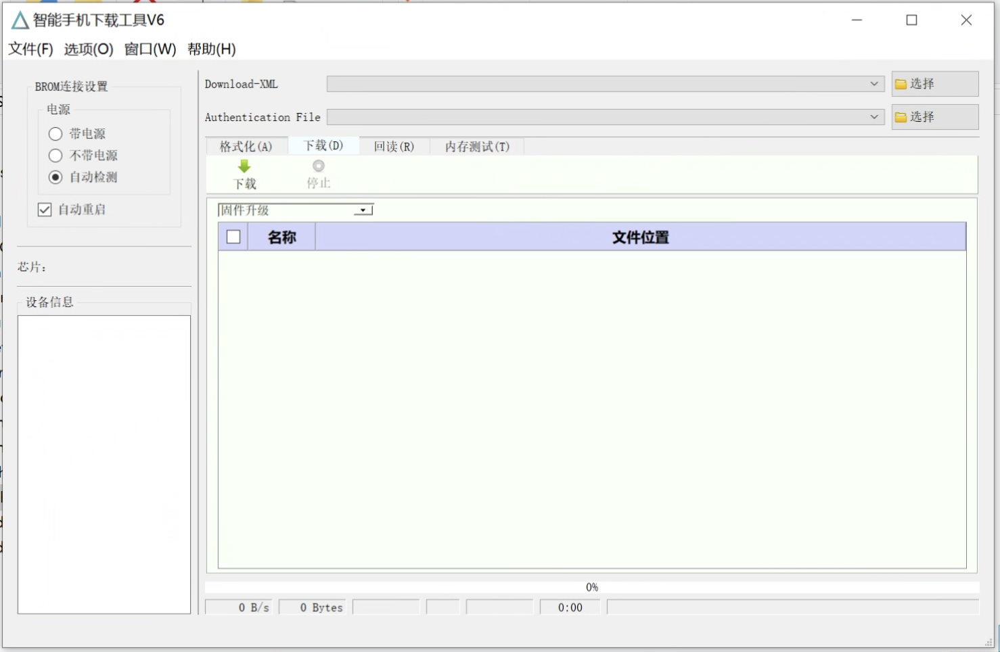

### 选择固件升级

载入 `flash.xml` 后，在「下载」页的模式下拉框中选择 **固件升级**。位置见下图红框。

:::caution[务必保留原厂校准数据]

**按本文步骤刷机，只选「固件升级」。务必不要选「全部格式化和下载」。** 全盘格式化会清除这台设备的原厂校准数据，可能显著影响无线电性能和相关功能。

除非你明确知道为何需要全盘格式化，并且有办法恢复本机的原厂校准数据，否则不要尝试。**即使他人或 AI 告诉你这个选项是安全的，也不要照做。**

:::

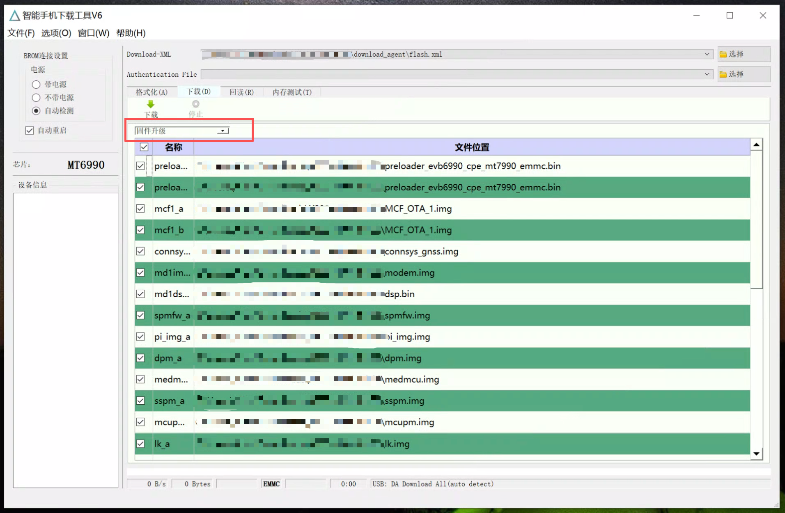

### 写入固件

**写入期间不要拔掉数据线，也不要切断 Air6 或电脑的电源。**

1. 保持 Air6 断电，先点击 SPFlashToolV6 中的 **下载** 按钮。
2. 用数据线将 Air6 的 USB-A 端口连接到 Windows 电脑。
3. 确认已点击 **下载**，且数据线两端都接稳后，再给 Air6 接通电源。工具会自动识别设备，写入 **39Wrt 系统和新版基带固件**。
4. 等待工具提示写入完成，再让设备自动重启并开机。

## 首次开机

刷机后默认使用全新的 **39Wrt FWA WebUI**。这套界面为 FWA 设备设计，首次使用时按向导设置即可。

1. 连接 Air6，在浏览器里打开默认管理地址 `192.168.39.1`。系统默认未设置 `root` 密码。
2. 在 FWA WebUI 中完成设备初始化向导。
3. **完成初始化后，LuCI 才会启动。** LuCI 使用设备的 `81` 和 `444` 端口。

## 系统界面展示

下面用 Air6 技术预览版的截图，看看刷机后能在管理界面里找到哪些设置和工具。

### 蜂窝网络

**图 1：射频配置。** 上方是飞行模式、网络模式、蜂窝数据和漫游设置，下方是 4G／5G 载波聚合、MIMO 和 SRS 天线轮发的开关。

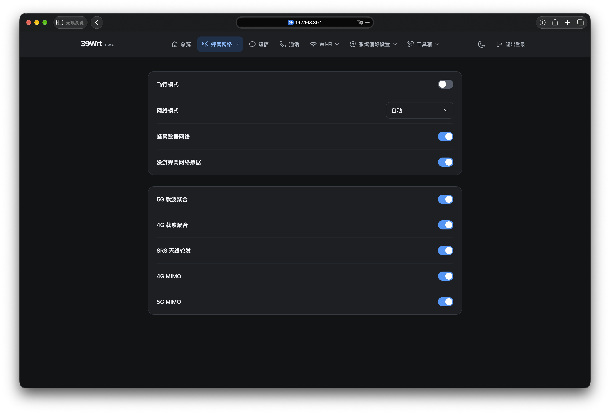

### Wi-Fi 配置

**图 2：2.4 GHz 设置。** 在这里可以调整 SSID、广播、加密方式和 AP 隔离，下方还提供 Wi-Fi 开关、发射功率和信道设置。

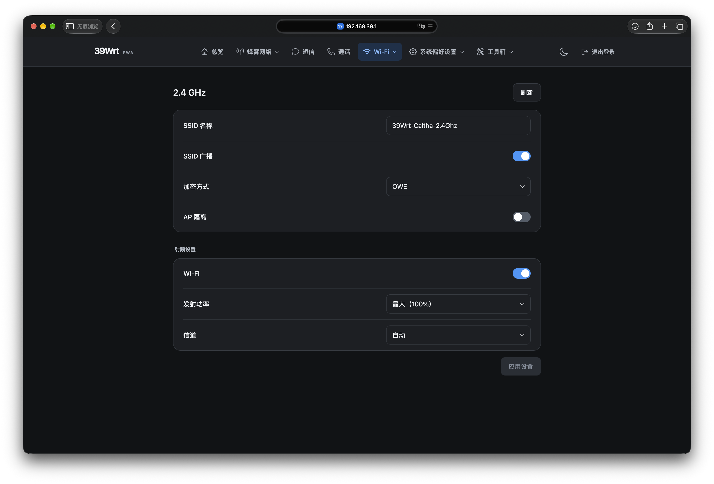

**图 3：频段设置入口。** 从 Wi-Fi 菜单可以进入 2.4 GHz、5 GHz 和 6 GHz 各自的设置页，也可以打开「多频合一 / MLO」。

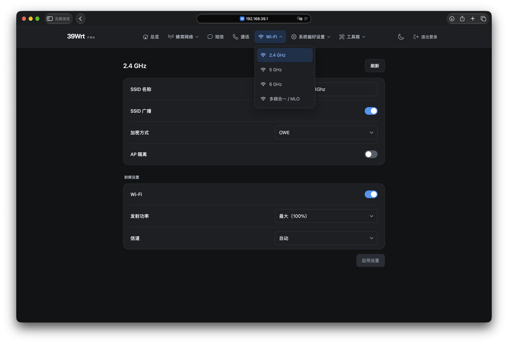

**图 4：工作模式。** 「多频合一 / MLO」页提供独立配置、多频合一与 MLO 三种模式。

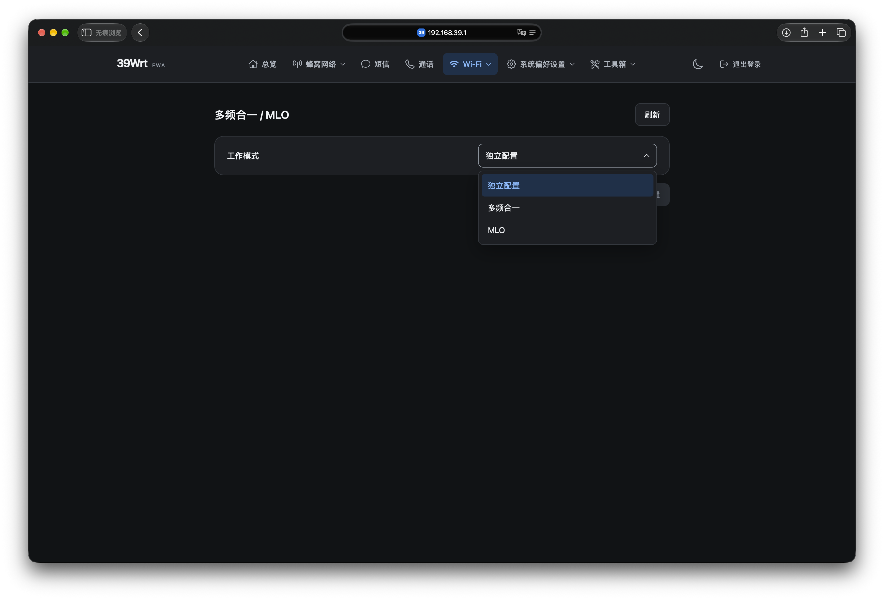

### 系统偏好设置

**图 5：UPnP 配置。** 页面汇总 UPnP IGD、PCP 和 NAT-PMP 的运行状态与活动映射，下方可以调整 MiniUPnP 的服务开关和访问规则。

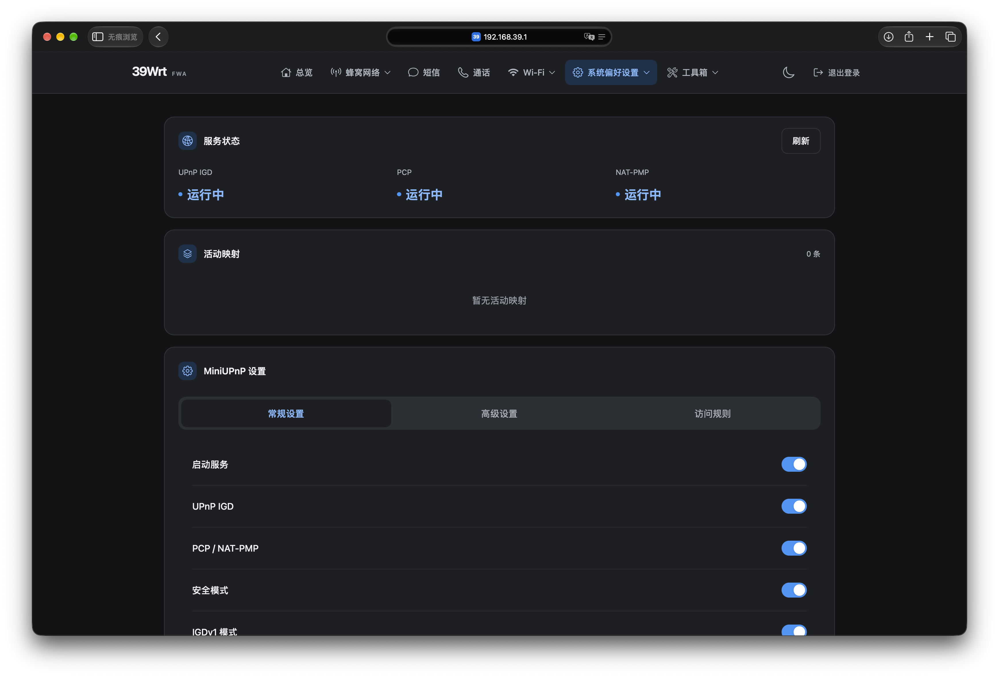

**图 6：辅助按钮。** 可以分别为长按、双击和三击指定动作，例如开关 LED 指示灯、飞行模式或某个 Wi-Fi 频段。

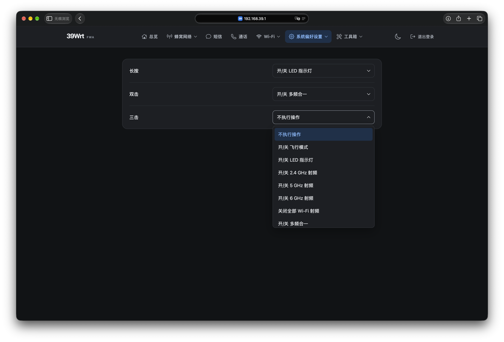

### USB 网络共享（EP 模式）

Air6 切到 **EP 模式**后，可以在 WebUI 开启「USB 网络共享」，再选择 ECM、NCM 或 RNDIS。

**图 7：ECM。** 选择 ECM 后，图中的 macOS 将 A775 识别为 USB 以太网设备，并显示对应的 ECM 驱动。

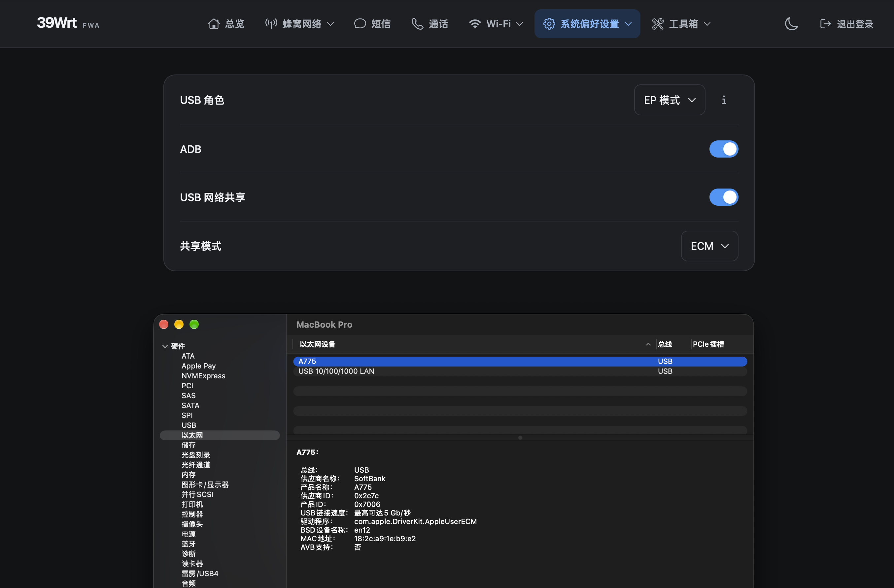

**图 8：NCM。** 切换到 NCM 后，macOS 的「以太网」列表同样显示 A775，驱动一栏显示 CDC NCM。

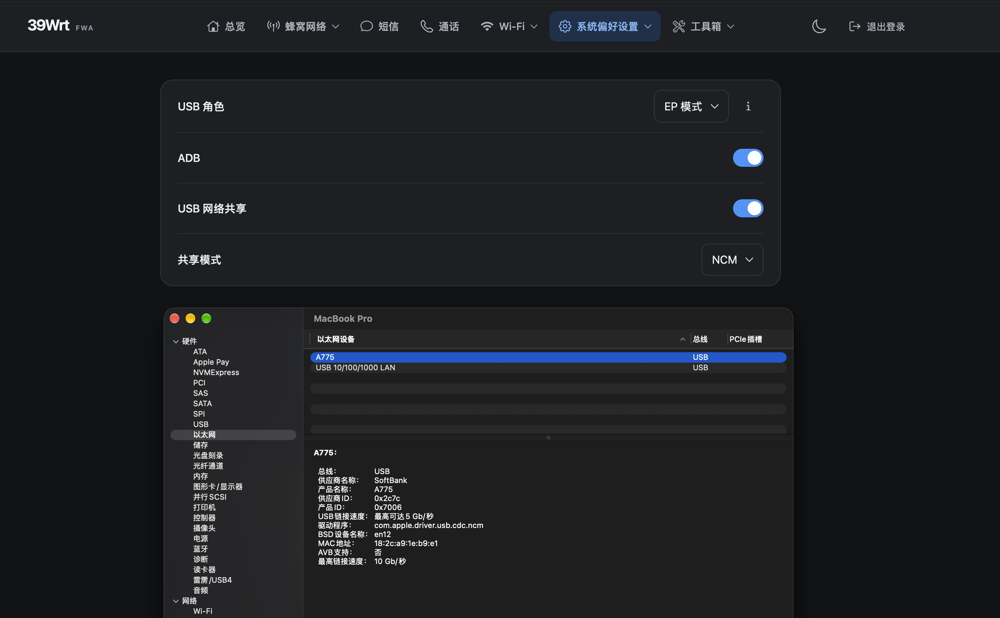

**图 9：RNDIS。** WebUI 的共享模式选为 RNDIS；下方的 macOS 系统信息显示 A775 已出现在 USB 设备列表中。

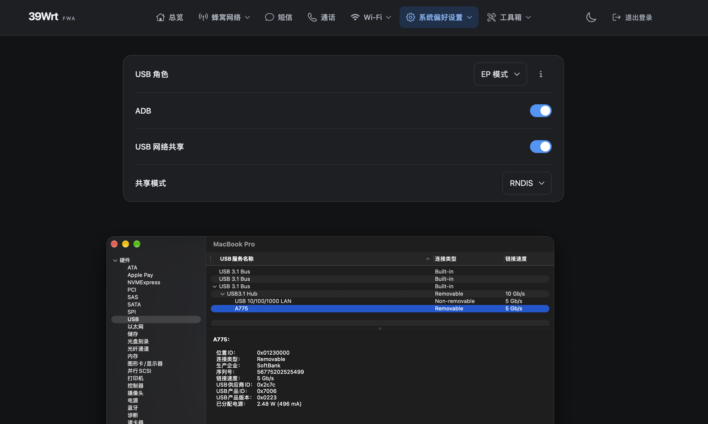

### 外接 WWAN 模块（RC 模式）

**图 10：外接 Quectel RM551E-GL。** Air6 切到 **RC 模式**后，通过 WWAN 转 USB 转接板接入模块。「已连接设备」列表会显示型号、USB 设备 ID 和 USB 链路速率，图中链路为 10 Gbps。

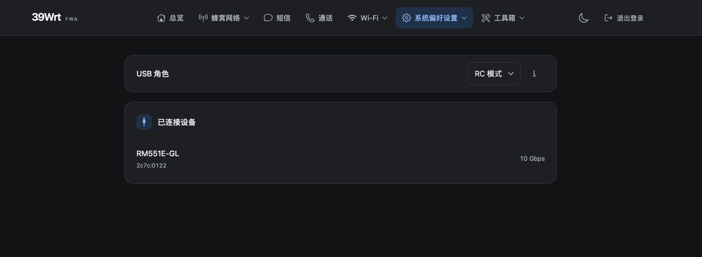

### 工具箱

**图 11：AT 调试。** 在工具箱中可以向基带发送 AT 命令并查看回复。图中发送 `AT` 后返回了 `OK`。

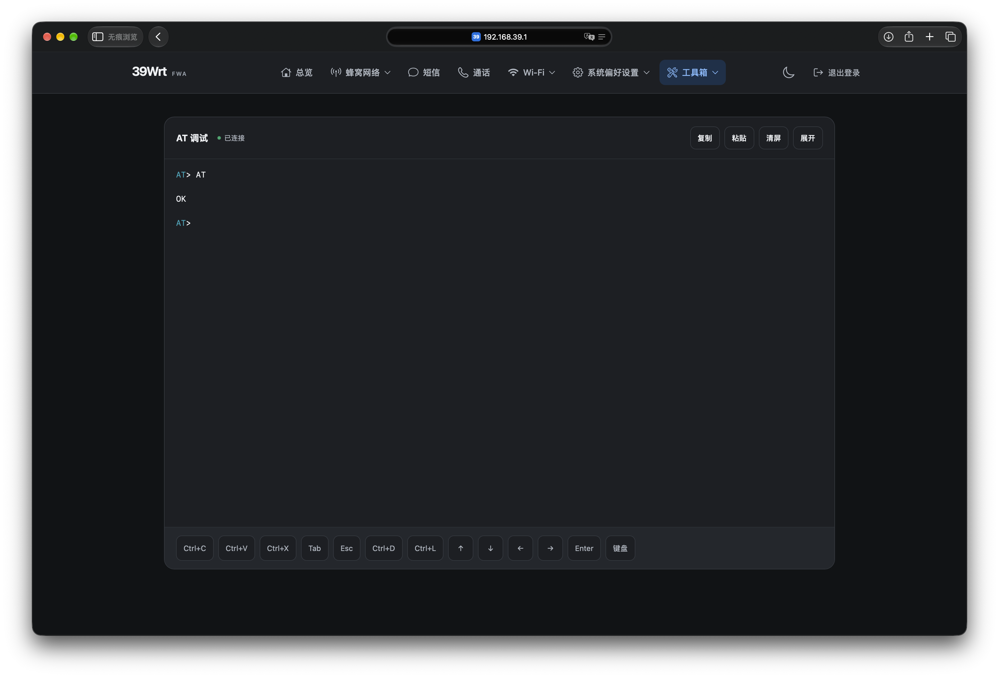

**图 12：TTYD。** 可以直接在浏览器里打开设备终端，图中已进入系统的 BusyBox shell。

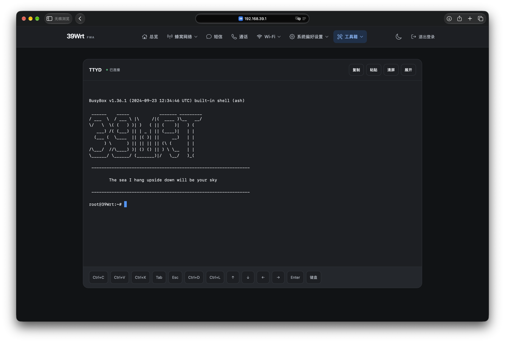

### 登录与 LuCI

**图 13：FWA WebUI 登录。** 页面提供 `root` 密码输入框，底部还可查看基带版本与 IP 地址状态。

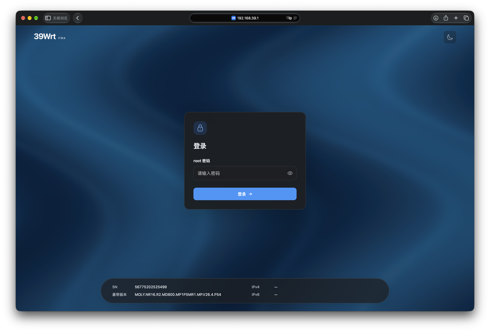

**图 14：LuCI 首页。** 状态页汇总设备型号、目标平台、固件和内核版本，也能查看运行时间、负载与内存用量。

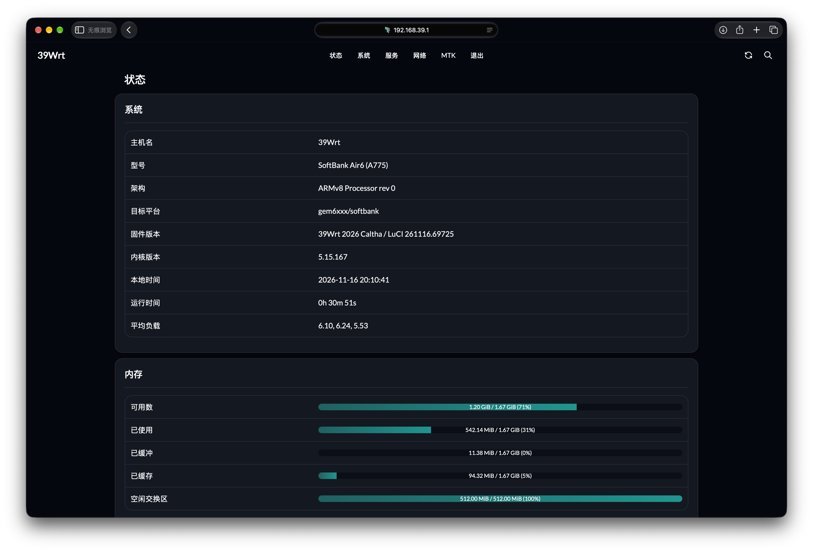

## 版本说明

**当前版本仅为技术预览版。** 部分功能还在开发，一些已实现的功能也还没有接入管理面板，后续会逐步补齐。
